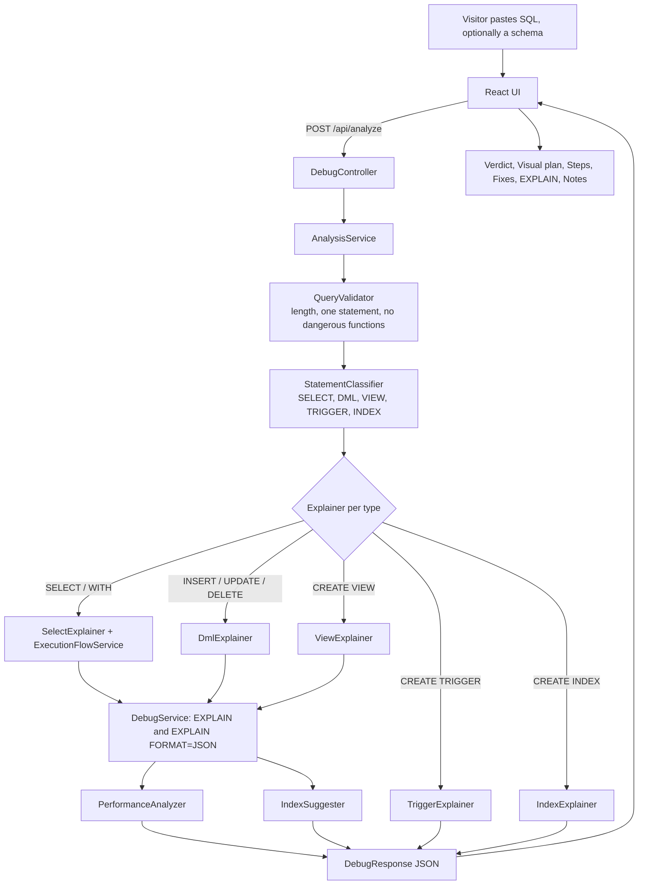

# 🐬 MySQL Query Debugger

> Paste a MySQL statement and see **how MySQL will run it**, **why it may be slow**, and **how to fix it**, without ever executing your statement.

**Live demo:** <https://mysql-debugger.onrender.com> (free hosting: the first visit after a quiet period can take up to a minute while the server wakes up)

Built with **Spring Boot 4 / Java 25** (analysis API), **React 18 + Vite** (UI) and **MySQL 8**.

---

## Table of contents

1. [What the project is](#1-what-the-project-is)
2. [Features](#2-features)
3. [How it works, end to end](#3-how-it-works-end-to-end)
4. [Technology stack](#4-technology-stack)
5. [Project structure](#5-project-structure)
6. [Backend in detail](#6-backend-in-detail)
7. [Frontend in detail](#7-frontend-in-detail)
8. [Database](#8-database)
9. [Running it locally](#9-running-it-locally)
10. [Configuration reference](#10-configuration-reference)
11. [Testing](#11-testing)
12. [CI](#12-ci)
13. [Deployment (GitHub → Render + Aiven)](#13-deployment-github--render--aiven)
14. [Security and privacy](#14-security-and-privacy)
15. [Troubleshooting](#15-troubleshooting)
16. [Limitations and ideas](#16-limitations-and-ideas)
17. [Explaining the project in two minutes](#17-explaining-the-project-in-two-minutes)
18. [License](#18-license)

---

## 1. What the project is

Slow SQL is hard to understand because MySQL's `EXPLAIN` output is a dense table of codes (`type=ALL`, `Using filesort`, `rows=19876`). This tool turns that into something a person can learn from:

1. **A step-by-step walk-through** of the order MySQL evaluates the statement (`FROM → JOIN → WHERE → GROUP BY → …`), with the matching part of your SQL highlighted at each step.
2. **A visual plan**: a diagram of how each table is read, plus a "row funnel" showing how many rows are read versus kept.
3. **Findings with a reason and a fix**: every problem says *what* MySQL is doing, *why it matters* (the cost) and *how to fix it*.
4. **Index suggestions** as ready-to-run `CREATE INDEX` statements, and a **"What if I add this index?"** button that compares the plan before and after on a temporary copy.
5. **Your own tables**: paste `CREATE TABLE` (and optional `INSERT`) statements and analyse a query against them, with nothing touching a real database.

The one rule the whole design follows: **your query is analysed, never executed.** Only `EXPLAIN` is sent to MySQL for it. (Table definitions you paste in "Use your own tables" are run, but only inside a throw-away schema that is dropped straight afterwards.)

**Who it is for:** students learning query tuning, developers checking a query before it ships, and anyone who wants to *see* why an index helps.

---

## 2. Features

### What it understands

| Statement | What you get |
|---|---|
| `SELECT` (joins, subqueries, `UNION`) | Logical flow `FROM → JOIN → WHERE → GROUP BY → HAVING → SELECT → DISTINCT → ORDER BY → LIMIT`, `EXPLAIN` and `EXPLAIN FORMAT=JSON`, performance findings |
| `WITH` / `WITH RECURSIVE` | Each CTE explained: merged into the query or materialized, and why; recursion rules |
| Window functions | A `WINDOW` step (partition → sort → frame), extra-sort detection, `LAST_VALUE` / ranking pitfalls |
| `INSERT`, `REPLACE`, `UPDATE`, `DELETE` | Row lifecycle: locate → triggers → constraints → write → commit; missing `WHERE`, unsafe `LIMIT`, scans that lock rows, batch size; warns when the table has triggers |
| `CREATE VIEW` | `MERGE` vs `TEMPTABLE` (and what blocks merging), `CHECK OPTION`, `EXPLAIN` of the view body |
| `CREATE TRIGGER` | When it fires relative to constraints and writes, per-row cost, invalid `NEW`/`OLD`, writes to its own table, `BEFORE` vs `AFTER` advice |
| `CREATE INDEX`, `ALTER TABLE … ADD INDEX` | Build process, usable column prefixes, duplicate or redundant indexes (checked against the real schema), `TEXT` prefix, low selectivity |

### Typical findings

Full table scan (a warning above 1,000 estimated rows, otherwise a notice), index available but not selected, filesort, temporary table, join buffer, `SELECT *`, leading wildcard in `LIKE`, `ORDER BY RAND()`, deep pagination, subquery in the select list, recursive CTE cost, ranking function without `ORDER BY`, `UPDATE`/`DELETE` without `WHERE`, trigger pitfalls, duplicate indexes, and more. Each has a severity: `WARNING`, `NOTICE` or `INFO`.

### The interface

| Feature | Description |
|---|---|
| **Verdict first** | One card with the headline ("1 thing to fix"), the biggest problem, the top fix (with a Copy button), and key numbers. Detail sits in tabs: *Visual plan · Steps · Fixes · EXPLAIN · Notes*. |
| **SQL editor** | CodeMirror 6: syntax colours, line numbers, bracket matching, **Format SQL**, and autocomplete for keywords, the connected database's tables and columns, and tables from a pasted schema. `Ctrl/⌘ + Enter` analyses. |
| **Example cards** | First screen: one click runs a ready-made example against the demo tables. |
| **Visual plan** | Table-access nodes colour-coded by access type, plus a row funnel. A "Show as table" alternative is included. All numbers are MySQL's *estimates*. |
| **Walk-through** | Stepper with a play/pause player; the part of your SQL that belongs to the current step stays highlighted. |
| **What if I add this index?** | Before/after comparison of access type, chosen index, estimated rows, cost, and whether the sort or temp table disappears. |
| **Use your own tables** | Paste a schema (and sample rows); "Load & check tables" shows what was created; a banner reminds you that schema mode is on. |
| **Tables panel** | Every table of the connected database with its exact row count; click one to fill the editor. |
| **History and share links** | Last 10 queries kept in your browser. **Share** puts the query in the URL fragment (`#q=…`), which is never sent to a server. Opening such a link runs the analysis. |
| **Light / dark / system theme** | Remembered in your browser. |
| **Responsive** | Works from phone to desktop; tables turn into stacked cards on narrow screens. |

---

## 3. How it works, end to end



When a **schema** is supplied, `AnalysisService` first asks `SchemaSandboxService` to create a temporary schema, run the pasted `CREATE TABLE` / `INSERT` statements in it, and run the whole analysis **inside** that schema. The temporary schema is dropped afterwards.

1. **Validate.** Reject empty or over-long input, stacked statements, executable comments and dangerous functions.
2. **Classify** the statement (`SELECT`, `INSERT`, …, `CREATE_TRIGGER`, `CREATE_INDEX`).
3. **Explain by type.** A parser-based explainer builds the human-readable *flow* (steps) and summary, plus SQL-level advice.
4. **Ask MySQL.** For statements MySQL can explain, run `EXPLAIN` (tabular) and `EXPLAIN FORMAT=JSON` (costs, filesort/temp-table flags).
5. **Analyse.** `PerformanceAnalyzer` turns plan + flow + query text into findings; `IndexSuggester` proposes indexes.
6. **Respond** with one JSON object. The UI renders it; nothing else is stored.

---

## 4. Technology stack

| Layer | Technology |
|---|---|
| Backend | Java 25, Spring Boot 4.1.1 (`spring-boot-starter-webmvc`, `spring-boot-starter-data-jdbc`), Maven, MySQL Connector/J, Jackson |
| Frontend | React 18, Vite 5, plain CSS with theme variables, CodeMirror 6 (`@codemirror/*`), `sql-formatter` |
| Database | MySQL 8 (8.4 in Docker Compose) |
| Tests | JUnit 5 (backend), Vitest + Testing Library + jsdom (frontend) |
| Packaging | Multi-stage `Dockerfile` (Node build → Maven build → small JRE image) |
| CI | GitHub Actions |
| Hosting used | Render (web service, Docker) + Aiven (managed MySQL) |

No router, no state library, no UI framework: the app is a single page.

---

## 5. Project structure

```
mysql-debugger/
├── README.md                    ← this file
├── DEPLOY.md                    ← short deployment notes
├── LICENSE                      ← MIT
├── Dockerfile                   ← builds React, bundles it into the Spring Boot jar, small runtime image
├── docker-compose.yml           ← MySQL 8.4 with demo data + the app, for one-command local start
├── .dockerignore / .gitignore
├── .github/workflows/ci.yml     ← backend tests, frontend tests + build, Docker build
│
├── db/
│   ├── 01-sample-data.sql       ← demo schema: customers (1,000), orders (20,000), order_audit
│   └── 02-app-user.sql          ← least-privilege MySQL user "debugger" + sandbox grant
│
├── backend/                     ← Spring Boot application
│   ├── pom.xml
│   └── src/
│       ├── main/java/com/mysqldebugger/
│       │   ├── MysqlDebuggerApplication.java     ← entry point
│       │   ├── config/JacksonConfig.java         ← JSON mapper bean
│       │   ├── controller/DebugController.java   ← all HTTP endpoints (/api/…)
│       │   ├── exception/
│       │   │   ├── ApiExceptionHandler.java      ← turns exceptions into {"error","message"} JSON
│       │   │   └── InvalidQueryException.java    ← "the input is not acceptable" error
│       │   ├── model/                            ← request/response data classes (see §6.4)
│       │   └── service/                          ← all the logic (see §6.2)
│       ├── main/resources/application.properties ← port, datasource, timeouts
│       └── test/java/com/mysqldebugger/…         ← 58 JUnit tests
│
└── frontend/                    ← React application
    ├── index.html, vite.config.js, package.json, package-lock.json
    └── src/
        ├── main.jsx             ← mounts <App/>
        ├── App.jsx              ← state, data flow, layout
        ├── api.js               ← the only place that calls the backend
        ├── samples.js           ← example queries (match db/01-sample-data.sql)
        ├── planModel.js         ← pure logic: EXPLAIN → visual plan, before/after comparison
        ├── sqlHighlight.js      ← pure logic: which part of the SQL a step refers to
        ├── styles.css           ← all styling, light/dark theme variables, responsive rules
        ├── components/          ← UI pieces (see §7.2)
        └── lib/                 ← small pure helpers (see §7.3)
```

---

## 6. Backend in detail

### 6.1 Layers

* **Controller** (`DebugController`): thin. Reads JSON, calls a service, returns JSON.
* **Services** (`service/`): everything else. They hold no per-visitor state except the sandbox slot pool.
* **Models** (`model/`): plain data classes and records that become the JSON.
* **Exception handler**: one place that converts failures into a consistent error JSON.

### 6.2 Services: what each class does

| Class | Responsibility |
|---|---|
| `AnalysisService` | **The orchestrator.** validate → classify → explain by type → `EXPLAIN` → findings → index suggestions. With a schema, runs all of it inside a sandbox and adds a note about empty or sampled data. Also adds a note when the target table has triggers. |
| `QueryValidator` | Safety checks *before* anything touches the database: max 20,000 characters, no executable comments (`/*! … */`), exactly one statement (a trigger body may contain `;`), no `SLEEP`, `BENCHMARK`, `LOAD_FILE`, `OUTFILE`, `DUMPFILE`. Strips comments and `DELIMITER` lines. |
| `StatementClassifier` | Looks at the first keyword(s) and returns a `StatementType`; understands `WITH … SELECT/INSERT/UPDATE/DELETE`, views, triggers, indexes. |
| `SelectExplainer` | Flow and summary for `SELECT` / `WITH … SELECT`; SQL-level advice (e.g. `ORDER BY RAND()`, deep pagination, subqueries). |
| `ExecutionFlowService` | Builds the ordered execution steps of a SELECT, including CTEs, window functions and `UNION`. Locates clauses on a "masked" copy of the query so keywords inside strings, functions or subqueries are never mistaken for real clauses. |
| `CteParser`, `WindowFunctionParser`, `SqlFeatures` | Small parsers: split `WITH` clauses, find `func() OVER (…)`, detect what blocks view/CTE merging. |
| `DmlExplainer` | Flow for `INSERT`, `REPLACE`, `UPDATE`, `DELETE` (target → locate → triggers → constraints → write → commit) and DML-specific findings. |
| `ViewExplainer` | Explains `CREATE VIEW`: stored vs run-time behaviour, `MERGE` vs `TEMPTABLE`, `CHECK OPTION`; explains the view's `SELECT` body. |
| `TriggerExplainer` | Explains `CREATE TRIGGER` from its definition only (it is never run). |
| `IndexExplainer` | Explains `CREATE INDEX` / `ALTER TABLE … ADD INDEX`: parses the definition, then checks it against the table's real indexes and columns (duplicate, redundant, `TEXT` prefix, very wide, low selectivity). |
| `DebugService` | The **only** class that runs SQL for analysis: `EXPLAIN`, `EXPLAIN FORMAT=JSON`, and `INFORMATION_SCHEMA` lookups for indexes, columns and triggers (all with bind parameters). |
| `JsonExecutionPlanService` | Parses MySQL's JSON plan into `JsonExecutionPlan` (cost, filesort and temporary-table flags, nested blocks). |
| `PerformanceAnalyzer` | Turns plan + flow + query text into `PerformanceIssue`s: full scan, unused index, filesort, temp table, join buffer, `SELECT *`, leading `LIKE '%…'`, and more. |
| `IndexSuggester` | For scanned tables, proposes `CREATE INDEX` using the usual rule: **equality columns first, then sort columns (or one range column)**. Skips ideas an existing index already covers. |
| `SchemaScript` | Validates and splits the pasted schema text. Accepts only `CREATE TABLE`, `CREATE INDEX`, `ALTER TABLE`, `INSERT INTO`. Rejects `SELECT` (so no `INSERT … SELECT`), qualified names (`db.table`), file options and dangerous functions. Limits: 100,000 characters, 200 statements. |
| `SchemaSandboxService` | **Temporary schemas.** Creates a throw-away schema, runs the work inside it on one pooled connection (held by a Spring transaction), then restores the original default schema and drops the sandbox. At most four sandboxes at once. Can fill a sandbox from a pasted schema or from a copy of the configured database (max 20 tables and about 500,000 rows). See §6.3. |
| `WhatIfService` | "What if I add this index?": analyses the query, applies **one** validated index to the temporary copy, analyses again, returns both. |
| `SchemaStatsService` | Lists the tables of the connected database with exact row counts (up to 50 tables) and the column names per table (for autocomplete). |
| `SqlText`, `SqlScan` | Shared text helpers: masking, quote skipping, bracket matching, splitting on top-level commas. |

### 6.3 Temporary schemas ("sandbox"), explained

Two features need a place to try things without touching real data: **your own tables** and **What if I add this index?**

* The app creates a schema, runs the pasted `CREATE TABLE` / `INSERT` statements (or copies the demo tables), runs `ANALYZE TABLE` so MySQL's statistics match the rows, performs the analysis, and **drops the schema** in a `finally` block.
* Everything runs on **one pooled connection** inside a transaction, so the normal `JdbcTemplate` calls elsewhere in the code transparently see the sandbox as the default schema.
* Concurrency is limited to **4** at a time; a fifth request gets "The server is busy… try again".
* **Schema naming has two modes:**
  * *Random names* (default): `sbx_<uuid>` per request. Needs a database user with `CREATE`/`DROP` on the pattern `` `sbx\_%` ``.
  * *Fixed names*: set `APP_SANDBOX_SCHEMAS=sbxslot1,sbxslot2,sbxslot3,sbxslot4`. Each name serves one request at a time (so the number of names is the concurrency). Use this on hosts that **do not support wildcard grants**, for example MySQL with `partial_revokes=ON`, which is the case on Aiven's MySQL. Grant the app user `ALL` on exactly those names instead.

### 6.4 Models

| Class | Purpose |
|---|---|
| `DebugRequest` | `{ query, schema? }` |
| `WhatIfRequest` | `{ query, schema?, indexDdl }` |
| `DebugResponse` | The analysis: `query`, `statementType`, `summary`, `executionFlow[]`, `executionPlan[]`, `jsonExecutionPlan`, `performanceIssues[]`, `indexSuggestions[]`, `notes[]` |
| `WhatIfResponse` | `{ indexDdl, before, after, copyOfDatabase }` (both are full `DebugResponse`s) |
| `ExecutionStep` | One step: `step`, `operation`, `description`, `expression`, `details` |
| `ExplainResult` | One row of tabular `EXPLAIN` (`table`, `type`, `key`, `rows`, `filtered`, `extra`, …) |
| `JsonExecutionPlan` | `queryCost`, `orderingUsingFilesort`, `groupingUsingTemporaryTable`, nested blocks |
| `PerformanceIssue` | `severity`, `title`, `description`, `reason`, `suggestion`, `table`, `estimatedRows`, related clause |
| `IndexSuggestion` | `table`, `columns`, `ddl`, `reason` |
| `TableStats` | `{ name, rows, columns }` |
| `StatementType` | `SELECT, CTE_SELECT, INSERT, REPLACE, UPDATE, DELETE, CREATE_VIEW, CREATE_TRIGGER, CREATE_INDEX, UNSUPPORTED` |
| `ExplainerResult`, `ColumnInfo`, `IndexInfo` | Internal carriers between explainers and analysers |

### 6.5 API reference

Base path `/api`. All bodies are JSON.

| Method and path | Purpose | Body → Response |
|---|---|---|
| `POST /api/analyze` (alias `/api/debug`) | Analyse one statement | `{query, schema?}` → `DebugResponse` |
| `POST /api/whatif` | Before/after for one index | `{query, schema?, indexDdl}` → `WhatIfResponse` |
| `POST /api/schema/check` | Load a pasted schema into a temporary database and list its tables | `{schema}` → `[{name, rows, columns}]` |
| `GET /api/tables` | Tables of the connected database with row counts | → `[{name, rows, columns}]` |
| `GET /api/columns` | Column names per table (autocomplete) | → `{ "customers": ["id","name",…] }` |

**Example**

```http
POST /api/analyze
Content-Type: application/json

{"query": "UPDATE orders SET status = 'ARCHIVED'"}
```

```json
{
  "statementType": "UPDATE",
  "summary": "UPDATE changes every row of 'orders'.",
  "executionFlow": [{ "step": 1, "operation": "TARGET", "description": "…", "expression": "orders", "details": "" }],
  "executionPlan": [{ "table": "orders", "type": "ALL", "rows": 19876 }],
  "jsonExecutionPlan": { "queryCost": 2012.5, "orderingUsingFilesort": false },
  "performanceIssues": [{
    "severity": "WARNING",
    "title": "UPDATE Without WHERE",
    "reason": "It touches and locks all rows, produces a huge undo log …",
    "suggestion": "Add a WHERE clause, or update in batches …"
  }],
  "indexSuggestions": [],
  "notes": ["…"]
}
```

**Errors** are always `{"error": "<CODE>", "message": "<text>"}`:

| HTTP | `error` | When |
|---|---|---|
| 400 | `INVALID_QUERY` | Empty/too long/stacked/dangerous/unsupported input, bad pasted schema, busy server |
| 400 | `INVALID_REQUEST` | Body is not valid JSON |
| 400 | `DATABASE_ERROR` | MySQL rejected something (syntax error, unknown table or column, no permission, connection problem) |
| 500 | `PLAN_PARSE_ERROR` | The JSON plan from MySQL could not be understood |

---

## 7. Frontend in detail

### 7.1 Data flow in `App.jsx`

* **State:** the SQL text, the optional schema, the last analysis result, the active tab, loading and error, the history list, and the connected database's tables and columns.
* **Run:** `run(sql, schema)` → `api.analyze` → store the result, switch to the *Fixes* tab, add to history, and write a share link into the address bar.
* **On load:** if the URL has `#q=…`, the query is filled in and analysed immediately. Tables and columns are fetched once for the tables panel and autocomplete.
* **Layout:** header → editor → (example cards when nothing has run yet) → verdict + tabs → tables panel.

### 7.2 Components (`src/components/`)

| Component | What it does |
|---|---|
| `Header` | Logo, title, tagline and the theme toggle. |
| `ThemeToggle` | System / Light / Dark switch; writes `data-theme` on `<html>`. |
| `Editor` | The input card: example dropdown, SQL editor, **Format SQL**, Analyze, the collapsible **Use your own tables** box (schema editor, *Load & check tables*, *Insert example*, *Clear*, result chips), and the "Schema mode is on" banner. Loads CodeMirror on demand and shows a plain textarea meanwhile. |
| `SqlEditor` | The CodeMirror 6 editor: colours from CSS variables (so it follows the theme), line numbers, bracket matching, autocomplete from `{table: [columns]}`, `Ctrl/⌘+Enter` to run, and syncing when the text is changed from outside (examples, history, format). |
| `ExampleCards` | First-screen gallery; one click fills the editor and runs. |
| `HistoryMenu` | "History" button with a popover of the last queries; open, remove one, or clear all. |
| `ShareButton` | Copies a link that re-opens the query. |
| `Verdict` | The answer first: tone icon, headline, biggest problem, top fix with Copy, key numbers, and "See all fixes". |
| `Tabs` | Accessible tabs (arrow keys, Home/End); only the active panel is rendered. |
| `VisualPlan` | The plan diagram (table nodes, join look-ups, temporary table, filesort, result) and the row funnel, with a "Show as table" alternative. |
| `FlowStepper` | The vertical step list with a play/pause walk-through and the pinned "Your query" panel that highlights the current step's SQL. |
| `Issues` | The findings list: severity, what, why it matters, how to fix. |
| `IndexSuggestions` | Suggested `CREATE INDEX` statements with Copy and **What if I add this index?**, which shows the verdict, a before/after table and cost bars. |
| `ExplainTable` | The raw MySQL `EXPLAIN` rows, with access-type badges. |
| `Notes` | "Good to know" notes (for example: empty tables give placeholder costs). |
| `TablesPanel` | Collapsible list of the database's tables with row counts; click to insert a `SELECT`. |
| `Overview` | An earlier summary card, superseded by `Verdict`. Not used by `App.jsx` and safe to delete. |

### 7.3 Helper modules

| File | Purpose |
|---|---|
| `api.js` | `analyze`, `fetchTables`, `fetchColumns`, `checkSchema`, `whatIf`. Every function turns network and server failures into a readable `Error(message)`. |
| `planModel.js` | Pure functions: `accessInfo` (access type → label, icon, tone), `buildPlan` (groups, post-steps, row funnel), `summarize` and `compareWhatIf` (before/after verdict). |
| `sqlHighlight.js` | `locateStep` finds which part of the query a flow step refers to (searching right after its keyword); `splitAround` cuts the text for rendering. |
| `samples.js` | The example queries. They use the demo tables. |
| `lib/verdict.js` | `buildVerdict(result)` → tone, headline, counts, biggest problem, top fix. |
| `lib/history.js` | Last 10 queries in `localStorage` (key `mysql-debugger:history:v1`); every storage call is guarded. |
| `lib/share.js` | Encodes `{sql, schema}` as base64url in `#q=…`; decodes safely; marks links over 8,000 characters as too long. |
| `lib/theme.js` | Stored theme (`system`, `light`, `dark`) and applying it to `<html>`. |
| `lib/format.js` | Loads `sql-formatter` on demand and formats MySQL; skips `DELIMITER` scripts. |
| `lib/schemaColumns.js` | Pulls table and column names out of pasted `CREATE TABLE` text and merges them into the autocomplete schema. |

### 7.4 Design notes

* **Performance:** the first page is about 60 KB gzipped. The editor (~140 KB) and the formatter (~75 KB) load on demand.
* **Accessibility:** tabs follow the WAI-ARIA pattern; severity and status always use an **icon and a label**, never colour alone; focus rings are visible; the plan has a table alternative.
* **Privacy:** history is stored only in your browser; share links keep the query in the URL fragment, which browsers do not send to servers.
* **Theme:** colours are CSS variables. Dark values apply for the system theme through `prefers-color-scheme` and for the explicit choice through `data-theme`.

---

## 8. Database

### 8.1 Demo schema (`db/01-sample-data.sql`)

| Table | Rows | Notes |
|---|---|---|
| `customers` | 1,000 | `id`, `name`, `email`, `city` |
| `orders` | 20,000 | `customer_id` is indexed; `status` and `created_at` deliberately are **not**, so full scans and filesorts are easy to see |
| `order_audit` | 0 | target of the audit-trigger example |

The script creates the `mysql_debugger` database, fills the tables with generated rows, and runs `ANALYZE TABLE`.

### 8.2 The app's MySQL user (`db/02-app-user.sql`)

Creates `debugger` with `SELECT, INSERT, UPDATE, DELETE, SHOW VIEW` on `mysql_debugger.*` (MySQL needs the privileges of the statement being explained) and `ALL` on `` `sbx\_%`.* `` for the sandbox. **Change its password before using it anywhere public.** On hosts that do not allow wildcard grants, grant the fixed sandbox names instead (see §6.3 and §13).

---

## 9. Running it locally

### Option A: Docker (one command)

```bash
docker compose up --build
# open http://localhost:8080
```

Starts MySQL 8.4 with the demo data and the app.

### Option B: development setup (Windows + IntelliJ friendly)

Prerequisites: JDK 25, Node 22, a MySQL 8 server.

```bash
# 1. database with demo data (run from the repo root)
mysql -u root -p < db/01-sample-data.sql

# 2. backend  → http://localhost:8080
cd backend
export DB_URL='jdbc:mysql://localhost:3306/mysql_debugger?allowPublicKeyRetrieval=true&useSSL=false'
export DB_USERNAME=root DB_PASSWORD=root
./mvnw spring-boot:run          # on Windows: mvnw.cmd spring-boot:run, or run MysqlDebuggerApplication in IntelliJ

# 3. frontend → http://localhost:5173 (proxies /api to :8080)
cd frontend
npm install
npm run dev
```

Notes:
* In IntelliJ, set `DB_URL`, `DB_USERNAME`, `DB_PASSWORD` as environment variables in the run configuration, or edit the defaults in `application.properties`.
* The command is `npm run dev` (not `run npm dev`).
* From the `backend` folder the SQL files are one level up: `..\db\01-sample-data.sql`.
* Production builds serve the React files from Spring Boot itself, so there is no separate frontend server.

---

## 10. Configuration reference

| Variable | Meaning | Default |
|---|---|---|
| `DB_URL` | JDBC URL, e.g. `jdbc:mysql://HOST:PORT/mysql_debugger?sslMode=REQUIRED` | `jdbc:mysql://localhost:3306/mysql_debugger` |
| `DB_USERNAME` | MySQL user | `root` |
| `DB_PASSWORD` | MySQL password | `root` |
| `PORT` / `SERVER_PORT` | HTTP port (hosts such as Render set `PORT`) | `8080` |
| `APP_SANDBOX_SCHEMAS` | Optional comma-separated fixed sandbox schema names, e.g. `sbxslot1,sbxslot2,sbxslot3,sbxslot4`. Leave unset to use random `sbx_<uuid>` names. | unset |
| `JAVA_OPTS` | Extra JVM options (set in the container) | `-XX:MaxRAMPercentage=75` |

`application.properties` also sets `spring.datasource.hikari.connection-timeout=30000`. The first connection to a remote database over TLS on a small, slow server can take longer than the old 5-second value.

**Never commit real passwords.** Put them in the hosting platform's environment settings.

---

## 11. Testing

```bash
cd backend  && mvn test                  # unit tests need no database; the context-load test needs MySQL
cd frontend && npm test && npm run build # Vitest + jsdom, then a production build
```

| Area | Tests | What they cover |
|---|---|---|
| Backend | 58 | validator, classifier, flow building (CTE, window, nesting), JSON-plan parsing, analyser rules, schema-script validation, schema stats, end-to-end analysis service, application context |
| Frontend | 50 | verdict, history, share links, theme, format, schema columns, the real CodeMirror editor, and App-level flows: first screen, tabs, history, share, theme, toolbar |

---

## 12. CI

`.github/workflows/ci.yml` runs on every push to `main` and on pull requests:

1. **backend:** starts a MySQL 8.4 service container and runs `mvn -B verify` on JDK 25.
2. **frontend:** Node 22, `npm ci`, `npm test`, `npm run build`.
3. **docker:** builds the production image (after the two jobs above pass).

---

## 13. Deployment (GitHub → Render + Aiven)

The app is **one container** (Spring Boot serving the built React UI) plus **a MySQL 8 database it can reach**. This section records the setup used for the live demo; the same pattern works on other hosts.

### 13.1 Push to GitHub

```bash
git add .
git commit -m "Your message"
git branch -M main
git remote add origin https://github.com/<your-username>/mysql-debugger.git   # empty repo created first
git push -u origin main
```

### 13.2 Database (Aiven free MySQL, as used here)

1. Create a MySQL service on the free plan and note host, port, user and password.
2. Create the database and load the demo data (type the password at the prompt rather than on the command line):
   ```bash
   mysql -h HOST -P PORT -u avnadmin -p --ssl-mode=REQUIRED -e "CREATE DATABASE IF NOT EXISTS mysql_debugger"
   mysql -h HOST -P PORT -u avnadmin -p --ssl-mode=REQUIRED < db/01-sample-data.sql
   ```
3. Create the limited app user (`db/02-app-user.sql`, **with your own password**; do not commit that password).
4. **Aiven specific:** it runs MySQL with `partial_revokes=ON`, so wildcard grants such as `` `sbx\_%` `` never take effect. Grant fixed names instead:
   ```sql
   GRANT ALL PRIVILEGES ON sbxslot1.* TO 'debugger'@'%';
   GRANT ALL PRIVILEGES ON sbxslot2.* TO 'debugger'@'%';
   GRANT ALL PRIVILEGES ON sbxslot3.* TO 'debugger'@'%';
   GRANT ALL PRIVILEGES ON sbxslot4.* TO 'debugger'@'%';
   ```
   and set `APP_SANDBOX_SCHEMAS=sbxslot1,sbxslot2,sbxslot3,sbxslot4` on the web service.

### 13.3 Web service (Render)

*New → Web Service → connect the GitHub repo → Language **Docker** → Instance type **Free** (or paid).* Set:

| Key | Value |
|---|---|
| `DB_URL` | `jdbc:mysql://HOST:PORT/mysql_debugger?sslMode=REQUIRED` |
| `DB_USERNAME` | `debugger` |
| `DB_PASSWORD` | the app user's password |
| `APP_SANDBOX_SCHEMAS` | `sbxslot1,sbxslot2,sbxslot3,sbxslot4` |

Render sets `PORT` itself. Every later `git push` to `main` redeploys automatically.

### 13.4 After it is live

* Open `/api/tables`; you should see your tables with row counts.
* Press **Ctrl+F5** after a UI update so the browser does not show a cached page.
* Rotate any password that has ever been pasted into a chat, ticket or screenshot.

### 13.5 Free-tier behaviour

* The free web service sleeps when idle; the first request can take up to about a minute (the JVM needs roughly 60 seconds to start on the free CPU).
* The free Aiven service can be powered off when unused. Turn it back on from its dashboard if the site reports a database error.

---

## 14. Security and privacy

**Analysed, not executed**

* Only `EXPLAIN` is sent to MySQL, and only for `SELECT`/DML text and for the body of a view. `CREATE TRIGGER`, `CREATE VIEW` and `CREATE INDEX` are parsed locally and never run.
* Stacked statements, executable comments, `SLEEP()`, `BENCHMARK()`, `LOAD_FILE()`, `INTO OUTFILE` / `DUMPFILE` are rejected before reaching the database.
* `INFORMATION_SCHEMA` lookups use bind parameters. Table and schema names that are built into SQL come from `INFORMATION_SCHEMA` or are generated by the server, and are backtick-quoted.

**Sandbox**

* The only visitor-written statements that are actually executed are the pasted table definitions and, for "What if", one validated `CREATE INDEX`, and only inside the temporary schema.
* Pasted schemas accept only `CREATE TABLE`, `CREATE INDEX`, `ALTER TABLE`, `INSERT INTO`; `SELECT`, `db.table` names and file options are rejected. Size and count limits apply.
* Temporary schemas are dropped after each request, and the connection's default schema is restored before it returns to the pool.

**Access control**

* There are **no accounts or logins**: this is a public tool over demo data. Anyone who can reach the site can analyse queries and see the demo tables' names, columns and row counts.
* Use a **dedicated database with demo data only**, and the **least-privilege user** from `db/02-app-user.sql`, never `root`.
* If abuse becomes a concern, add rate limiting at a reverse proxy or in Spring.

**Secrets**

* Passwords live only in environment variables of the host. They are not in the repository.
* Query history and the theme are kept in the visitor's browser (`localStorage`); share links keep the query in the URL fragment.

---

## 15. Troubleshooting

| Symptom | Cause and fix |
|---|---|
| `'run' is not recognized` | The command is `npm run dev`. |
| `customers` table does not exist | Load the demo data: `mysql -u root -p < db/01-sample-data.sql` (from the repo root; from `backend` use `..\db\…`). In schema mode the demo tables are intentionally unavailable. |
| `Failed to obtain JDBC Connection` / *Connection attempt exceeded defined timeout* | Remote database over TLS is slower than the timeout. Use `spring.datasource.hikari.connection-timeout=30000` (already the default here). |
| Render: *No open ports detected* / *Timed Out* | The free instance is slow to start (~60 s). Check the log for a real `Caused by:` error; if there is none, redeploy with **Manual Deploy → Deploy latest commit**. |
| `Access denied … to database 'sbx_…'` | The app user cannot create temporary schemas. On most MySQL servers: `GRANT ALL PRIVILEGES ON \`sbx\_%\`.* TO …`. On hosts with `partial_revokes=ON` (e.g. Aiven): use `APP_SANDBOX_SCHEMAS` with fixed names and grant those. |
| Error persists after a fix | The browser may be showing a cached page. Press **Ctrl+F5**. |
| *The server is busy analysing other schemas* | All four sandbox slots are in use. Retry in a moment. |
| MySQL ignores a suggested index in "What if" | With tiny tables a full scan is cheaper. The result then says "No change". Use more rows. |
| Site slow on first visit | Free hosting sleeps when idle. |

---

## 16. Limitations and ideas

**Limitations**

* Explanations come from parsing the SQL text plus MySQL's `EXPLAIN`: guidance, not a substitute for measuring on production-sized data. Optimizer behaviour differs between MySQL versions.
* All row counts and costs are **estimates** from table statistics.
* Index suggestions follow the equality → sort → range rule and do not use column cardinality yet.
* For `UNION`, the step-by-step flow covers the first `SELECT` and summarises the rest.
* Triggers and indexes are explained from their definition; MySQL cannot `EXPLAIN` objects that do not exist yet.
* Concurrency of the sandbox features is limited to four.

**Ideas**

* Use cardinality statistics in index suggestions.
* Export a report (Markdown/PDF) of an analysis.
* Optional rate limiting and an optional login for private deployments.
* Support for more dialects (PostgreSQL `EXPLAIN`).

---

## 17. Explaining the project in two minutes

**The problem.** `EXPLAIN` output is cryptic. People see "type: ALL, Using filesort" and don't know what it costs or what to change.

**The idea.** Turn the plan into a story: a step-by-step walk-through, a picture of how tables are read, and findings that say *what, why it matters, how to fix*. Let people test a fix ("what if I add this index?") without risk.

**The design rule.** The statement is **never executed**. Only `EXPLAIN` runs, behind a validator that blocks stacked statements and dangerous functions.

**The pipeline.** *Validate → classify → explain by statement type → EXPLAIN → analyse → suggest indexes → one JSON response.*

**Why the sandbox exists.** To analyse a visitor's own tables, or to test an index, the app builds a temporary schema, does the work inside it on a single connection, and drops it afterwards, so real data is never touched.

**Why a Spring Boot + React split.** The backend owns anything that must be trusted (validation, database access, analysis); the frontend only renders. In production the React build is bundled into the Spring Boot jar, so it ships as one container.

**What makes the UI approachable.** The verdict comes first; details are in tabs; examples run in one click; the editor autocompletes your tables; history and share links make results easy to revisit and send.

**Honest limits.** Estimates, not measurements; no accounts (demo data only); free hosting sleeps.

**Questions people ask**

* *Is it safe to paste a real query?* It is analysed, not executed, and nothing is stored on the server. Do not paste secrets.
* *Why do indexes sometimes not help in the demo?* MySQL chooses a full scan when tables are tiny. The what-if result says so.
* *Why no login?* It is a public tool over demo data; the protection is a limited database user, validation, and size and concurrency limits.
* *How does it find which part of my SQL a step refers to?* The backend returns each step's literal expression; the frontend searches for it right after its clause keyword and highlights that range.
* *How would you scale it?* Add rate limiting, raise the sandbox slot count, and move to a larger instance.

---

## 18. License

MIT. See [LICENSE](LICENSE).